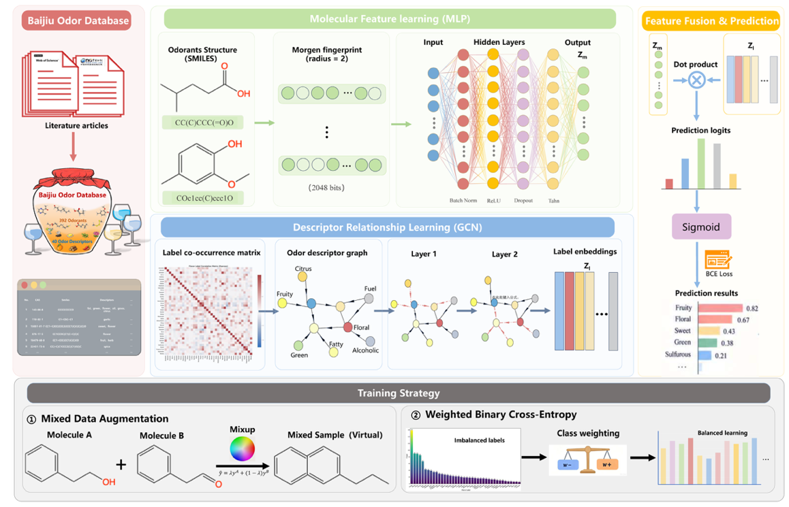

# BF-MLGCN: A Multi-Label Graph Convolutional Network for Predicting Odor Descriptors of Baijiu Flavor Compounds



## Overview

**BF-MLGCN** is a domain-specific deep learning framework designed to predict multi-label odor descriptors of aroma-active volatile compounds in Chinese Baijiu. By integrating a multi-layer perceptron-based molecular feature extractor (operating on 2048-bit Morgan fingerprints, radius = 2) with a graph convolutional network operating on a 40 × 40 odor-label correlation graph, BF-MLGCN captures both molecular structural features and semantic co-occurrence dependencies among sensory descriptors.

- **Web Server**: [https://www.bj-flavor.com/](https://www.bj-flavor.com/)

## Repository Contents

- `baijiu.csv`: Curated Baijiu aroma dataset comprising 392 volatile compounds (canonical SMILES) and binary annotations across 40 standardized odor descriptors.
- `best_model.pth`: Trained BF-MLGCN model weights.
- `run.py`: Standalone inference script for single-molecule (SMILES) or batch (CSV) odor descriptor prediction.
- `Fig1.png`: Architecture of the BF-MLGCN framework.

## Requirements

- Python >= 3.9
- PyTorch >= 2.0
- RDKit >= 2023.9
- NumPy >= 1.24
- Pandas >= 2.0

Install dependencies via pip:

```bash
pip install torch numpy pandas rdkit
```

## Usage

### 1. Single-Compound Odor Prediction

Predict odor descriptors and probabilities for an individual molecule using its SMILES string:

```bash
python run.py --smiles "CC1=CSC(=N1)C" --model best_model.pth --threshold 0.5
```

### 2. Batch Odor Prediction from CSV

Prepare a CSV file containing a `SMILES` (or `smiles`) column and run batch inference:

```bash
python run.py --csv molecules.csv --model best_model.pth --threshold 0.5 --output output.csv
```
